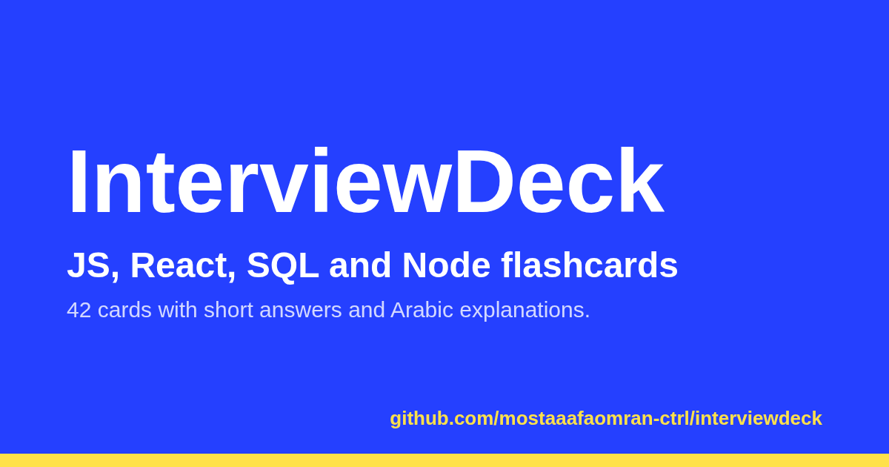

# InterviewDeck

Dev interview flashcards with Arabic explanations.

**Live:** https://mostaaafaomran-ctrl.github.io/interviewdeck/

## What it does

- 42 cards: JavaScript, React, SQL, Node
- Flip cards, shuffle, filter by topic
- Mark what you know, progress saved in your browser
- Cards live in one file, easy to add more with a pull request

## Use it

Open the live link. No signup, no server. To run it locally, clone the repo and open `index.html` in a browser.

## بالعربي

٤٢ كارت لأسئلة المقابلات في JavaScript وReact وSQL وNode، بإجابة قصيرة وشرح بالعربي.

## License

MIT
